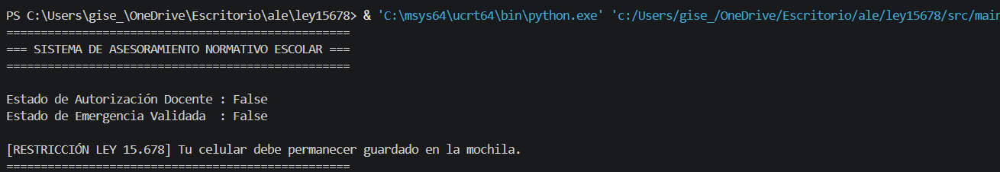

# Ley 15.678 — Simulador de Normativa de Celulares en el Aula

Proyecto académico para la materia **Laboratorio de Programación (LPR 5° Año)** de la **E.E.S.T. N° 1 de Vicente López**.

El repositorio contiene un script en Python que simula, de forma simple, la aplicación de la normativa escolar sobre el uso de celulares en el aula, tomando como referencia la **Ley 15.678**. A partir de variables de contexto, el programa indica si el uso del celular está permitido con fines pedagógicos, si debe canalizarse una emergencia por vía institucional, o si el dispositivo debe permanecer guardado.

## Datos del trabajo

- **Actividad:** Actividad 10 BIS — Simulador de Normativa de Celulares en el Aula (Ley 15.678)
- **Título del informe:** Conciencia Digital, Algoritmos y Marco Legal
- **Estudiante:** Alexander Luca Veit
- **Profesor:** Mansilla Muñoz York E.
- **Curso:** Laboratorio de Programación 5°6
- **Escuela:** E.E.S.T. N° 1 de Vicente López
- **Fecha del informe:** 24/10/2026

## Contenido del repositorio

```text
ley15678/
├── capturas/
│   └── ejecucion_terminal.png      # Captura de la ejecución del programa
├── docs/
│   └── InformeEEST1_LPR2026_ACT10_Ley_Veit_v1.0.0.pdf  # Informe académico
├── src/
│   └── main.py                     # Script principal
├── .gitignore
├── LICENSE
└── README.md
```

## Funcionamiento del programa

El script [`src/main.py`](src/main.py) define dos variables de contexto:

- `autorizacion_docente`: indica si el docente habilitó una actividad digital.
- `emergencia_familiar`: indica si existe una emergencia familiar validada por preceptoría/dirección.

Con una estructura condicional (`if / elif / else`), el programa muestra uno de estos resultados:

| Condición | Resultado |
|---|---|
| `autorizacion_docente == True` | **[ACCESO PERMITIDO]** El celular solo para estudiar y para aprender (fines pedagógicos). |
| `emergencia_familiar == True` | **[CANALIZACIÓN INSTITUCIONAL]** Gestionar la comunicación urgente a través de preceptoría y/o dirección. |
| Ninguna de las anteriores | **[RESTRICCIÓN LEY 15.678]** Tu celular debe permanecer guardado en la mochila. |

## Ejecución

Requisito: tener **Python 3** instalado.

Desde la raíz del repositorio:

```bash
python src/main.py
```

### Salida esperada (valores por defecto)

Con los valores actuales del script (`autorizacion_docente = False`, `emergencia_familiar = False`):

```text
==================================================
=== SISTEMA DE ASESORAMIENTO NORMATIVO ESCOLAR ===
==================================================

Estado de Autorización Docente : False
Estado de Emergencia Validada  : False

[RESTRICCIÓN LEY 15.678] Tu celular debe permanecer guardado en la mochila.
==================================================
```

Para probar otros escenarios, editar las variables en [`src/main.py`](src/main.py) y volver a ejecutar el script.

## Captura de ejecución



## Documentación

El informe académico incluido en [`docs/InformeEEST1_LPR2026_ACT10_Ley_Veit_v1.0.0.pdf`](docs/InformeEEST1_LPR2026_ACT10_Ley_Veit_v1.0.0.pdf) desarrolla:

- **Introducción:** estructura general del informe en formato APA (7ª edición) y conceptos básicos de programación en Python, como condicionales (`if`, `elif`, `else`).
- **Desarrollo:** temas trabajados en la actividad (entornos de desarrollo, variables, estructuras de control, operadores, tipos de datos, compilación y ejemplos de código), junto con un diagrama de flujo y preguntas técnicas referidas a la Ley 15.678.
- **Conclusión:** reflexión sobre la concientización en el uso del celular/pantallas durante la clase, sus efectos en la atención y su posible aporte como herramienta de estudio.

## Conceptos aplicados

- Variables booleanas para representar el contexto del aula.
- Estructuras condicionales en Python (`if`, `elif`, `else`).
- Salida por consola con `print`.
- Modelado simple de una situación normativa mediante lógica de programación.

## Referencias

- Python Docs — Estructuras de control (`if`, `elif`, `else`): https://docs.python.org/es/3/tutorial/controlflow.html

## Licencia

Este proyecto se distribuye bajo la licencia [MIT](LICENSE).
